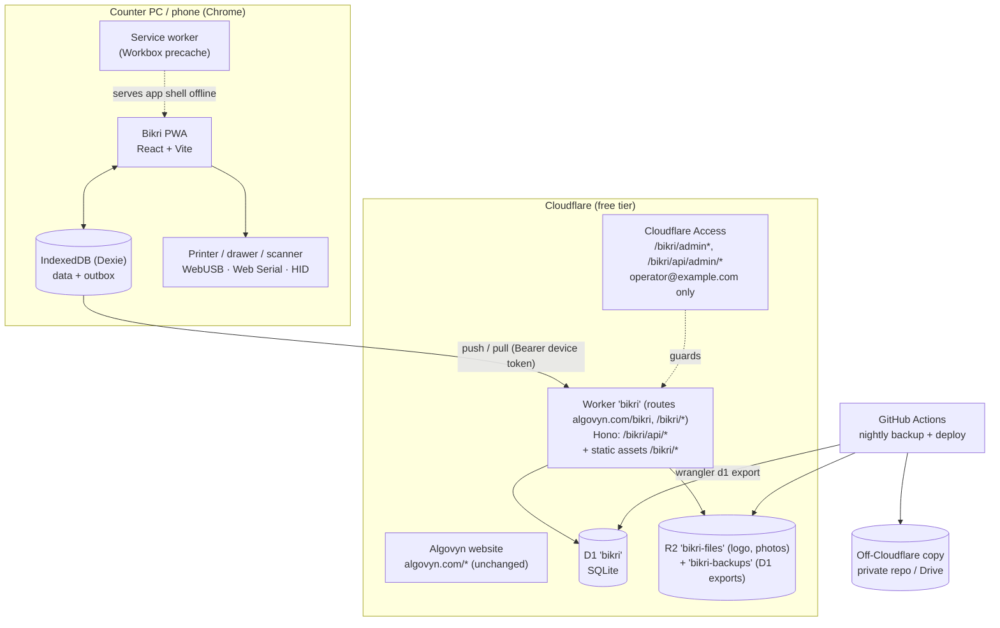

# 01 — Architecture

## 1. Summary

| Concern | Decision |
|---|---|
| Client | React 19 + Vite + TypeScript PWA (`apps/pos`) |
| Local data | IndexedDB via Dexie 4 — the till's source of truth for reads and writes |
| Server | One Cloudflare Worker (`apps/api`) running Hono: JSON API under `/bikri/api/*` + static assets for the PWA under `/bikri/` |
| Database | Cloudflare D1 (SQLite), binding `DB` |
| Files | Cloudflare R2 bucket `bikri-files`, binding `FILES` (logo, product photos only); separate bucket `bikri-backups`, binding `BACKUPS` (nightly D1 exports, admin-only) |
| Auth | Device token (Bearer) for the till API; staff PIN on the device; Cloudflare Access (email OTP, only `operator@example.com`) for `/bikri/admin*` and `/bikri/api/admin/*` |
| Sync | Outbox push + cursor pull ([03-sync](03-sync.md)) |
| Printing | Printer-agnostic ESC/POS over WebUSB **or** Web Serial, 58 mm or 80 mm paper; browser print (`window.print`) fallback ([06-printing](06-printing.md)) |
| Hosting | Cloudflare free tier, **path-based at `https://algovyn.com/bikri/`** on the existing `algovyn.com` zone, via Worker routes (§5.3) |
| Backups | GitHub Actions nightly `wrangler d1 export` → R2 + encrypted off-Cloudflare copy |

### Why React (not Svelte)

Svelte would ship a smaller bundle, but the service worker caches the app so bundle size only matters on first load. React wins on the libraries Bikri relies on: `dexie-react-hooks` (`useLiveQuery` re-renders when IndexedDB changes), `react-i18next` with RTL, TanStack Router/Virtual for long lists, and Radix primitives that handle focus, keyboard and RTL. It is also the most widely known stack if another developer or agent takes over.

### Why one Worker with static assets (not Pages + Worker)

Cloudflare Workers can serve static assets directly. One deployable means one origin (no CORS), one `wrangler.jsonc`, one CI job, and the API and the app versions always match. Cloudflare Pages + Functions would also work; this doc assumes Workers static assets.

### 1.1 URL layout and the path convention used in these docs

Bikri lives at **`https://algovyn.com/bikri/`** (decision D-021). It is not a subdomain: the rest of `algovyn.com` stays the Algovyn website.

| Public URL | Served by | Notes |
|---|---|---|
| `https://algovyn.com/` and every path not under `/bikri` | the existing Algovyn website (unchanged) | Bikri never touches these paths |
| `https://algovyn.com/bikri` | Bikri Worker (asset server) | redirected to `/bikri/` by the asset server's default `html_handling: "auto-trailing-slash"` (the Worker script does not run for it) |
| `https://algovyn.com/bikri/` … (`/bikri/sell`, `/bikri/settings/printer` …) | Bikri Worker → static assets (SPA) | app routes |
| `https://algovyn.com/bikri/api/*` | Bikri Worker → Hono | till API (device token) |
| `https://algovyn.com/bikri/admin*` | Bikri Worker → static assets, behind Cloudflare Access | owner admin UI |
| `https://algovyn.com/bikri/api/admin/*` | Bikri Worker → Hono, behind Cloudflare Access | owner admin API |

**Convention:** everywhere else in these docs (screen specs, sync, API tables), app routes such as `/sell`, `/enrol`, `/admin` and API paths such as `/api/sync/push` are written **relative to the base path `/bikri`**. So `/sell` means `https://algovyn.com/bikri/sell` and `/api/sync/push` means `https://algovyn.com/bikri/api/sync/push`. Never hard-code `/bikri` in components or fetch calls; use the single constants below.

| Where | Setting |
|---|---|
| `packages/core/src/paths.ts` | `export const BASE_PATH = '/bikri'; export const API_BASE = `${BASE_PATH}/api`;` (used by the client `fetch` wrapper and the Worker) |
| `apps/pos/vite.config.ts` | `base: '/bikri/'`, `build.outDir: 'dist/bikri'` (assets directory must mirror the public path, §5.1) |
| TanStack Router | `createRouter({ routeTree, basepath: '/bikri' })` |
| Hono | `new Hono().basePath('/bikri/api')` |
| PWA manifest | `id: '/bikri/'`, `start_url: '/bikri/'`, `scope: '/bikri/'` (§6) |
| Service worker | file `/bikri/sw.js` → default scope `/bikri/`; never registered at `/` |
| Vite dev server | `http://localhost:5173/bikri/`, proxy `/bikri/api` → `wrangler dev` on `:8787` |

## 2. System diagram



## 3. Stack and versions

Pin exact versions in `package.json` at scaffold time. The table lists the latest stable versions checked on 26 Oct 2026; use these or newer patch/minor releases.

| Package | Version | Where | Notes |
|---|---|---|---|
| Node.js | 24 LTS | tooling | `.nvmrc` = `24` |
| pnpm | 12.x | tooling | `packageManager` field |
| turbo | 2.11 | tooling | task pipeline |
| @biomejs/biome | 2.6 | tooling | lint + format |
| typescript | **7.0.2** (exact) | all | Latest stable on npm, checked 27 Oct 2026 (`npm view typescript version` → `7.0.2`; `beta` is 7.1.0-beta). Native (Go) compiler. See §3.1 |
| react / react-dom | 19.3 | pos | |
| vite | 8.3 | pos | |
| vite-plugin-pwa | 2.0 | pos | Workbox `generateSW`, `registerType: 'prompt'` |
| @tanstack/react-router | 1.170 | pos | file-based routes |
| @tanstack/react-virtual | 3.14 | pos | product grid, long lists |
| tailwindcss | 4.3 | pos | CSS-first config with tokens from doc 08 |
| Radix UI primitives / shadcn/ui | latest | pos | dialogs, tabs, popovers |
| dexie / dexie-react-hooks | 4.4 / 4.4 | pos | |
| zustand | 5.0 | pos | carts, UI state |
| i18next / react-i18next | 26.5 / 17.1 | pos | |
| react-hotkeys-hook | 5.3 | pos | |
| ulidx | 2.4 | core | `monotonicFactory()` |
| zod | 4.6 | core, api, pos | |
| hono | 4.13 | api | |
| @hono/zod-validator | 0.9 | api | |
| drizzle-orm / drizzle-kit | 0.45 / 0.31 | db, api | typed D1 queries; drafts later migrations. `0001_init.sql` is hand-written from [02 §2](02-data-model.md#2-d1-schema-migration-0001_initsql) and is the source of truth (CHECKs, partial unique indexes); the Drizzle schema must mirror it, checked by `drizzle-kit generate` producing no diff in CI |
| wrangler | 4.152 | api | |
| @cloudflare/workers-types | 2026-10 | api | |
| papaparse | 5.7 | pos | CSV import/export |
| read-excel-file | 9.3 | pos | XLSX import (read only) |
| pdf-lib | 1.17 | pos | PDF report export |
| zxing-wasm | 3.1 | pos | camera barcode fallback |
| vitest | 5.0 | all | unit tests |
| @cloudflare/vitest-plugin | 1.4.8 | api | Worker + D1 integration tests (renamed from vitest-pool-workers; [D-055](decisions.md)) |
| fake-indexeddb | 6.2 | pos tests | Dexie in Node |
| @playwright/test | 1.64 | e2e | |

### 3.1 TypeScript 7 notes (decision D-024)

- Pin `"typescript": "7.0.2"` (exact) in the root `devDependencies`; `pnpm typecheck` = `tsc -b` (project references). TS 7.0 is the native Go port: same language, much faster `tsc`, but **7.0 ships no programmatic compiler API** (Microsoft expects a new API in 7.1).
- Tools in this stack that only *transpile* or run `tsc` as a CLI are unaffected: Vite (own transform pipeline, no type checking), Vitest, Biome (own parser; we use Biome, not ESLint), wrangler/esbuild, drizzle-kit, TanStack Router's route generator.
- If a tool ever needs to `import 'typescript'` (e.g. typescript-eslint, which as of Oct 2026 still declares `typescript <6.1`), do **not** downgrade: use Microsoft's side-by-side aliases and record it in `docs/decisions.md`:
  ```json
  "devDependencies": {
    "@typescript/native": "npm:typescript@7.0.2",
    "typescript": "npm:@typescript/typescript6@6.0.2"
  }
  ```
  After switching, delete `node_modules`, reinstall and confirm `pnpm exec tsc --version` prints `7.0.2`.
- tsconfig: `strict: true`, `module: "preserve"`, `moduleResolution: "bundler"`, `target: "es2024"`, `verbatimModuleSyntax: true`, `noUncheckedIndexedAccess: true`. Do not use options deprecated in TS 6.0 (e.g. `baseUrl`, `moduleResolution: "node"`/`"node10"`, `target: "es5"`, `outFile`); 7.0 removes them. Use `paths` relative to the tsconfig and pnpm workspace packages instead of `baseUrl`.
- Editors: use the workspace TypeScript version.

Fonts (self-hosted, precached): **Inter** (UI Latin, tabular numerals), **Noto Nastaliq Urdu** (Urdu UI and receipts), **JetBrains Mono** (receipt preview only). All are SIL OFL.

## 4. Repository layout

```
bikri/
├─ AGENTS.md  README.md  LICENSE
├─ package.json  pnpm-workspace.yaml  turbo.json  biome.json  .nvmrc
├─ .github/workflows/
│   ├─ ci.yml             lint, typecheck, unit, e2e (on PR)
│   ├─ deploy.yml         website check + build + wrangler deploy (on main)
│   ├─ website-guard.yml  nightly + manual: tools/check-website.mjs against the live algovyn.com
│   └─ backup.yml         nightly D1 export (cron)
├─ apps/
│   ├─ pos/               React PWA
│   │   ├─ index.html  vite.config.ts
│   │   ├─ public/        icons, fonts, manifest assets
│   │   └─ src/
│   │       ├─ main.tsx  app.tsx
│   │       ├─ routes/    one folder per screen (see docs/screens)
│   │       ├─ components/  shared UI (KeyBadge, MoneyInput, PinPad, Rail…)
│   │       ├─ data/      Dexie db, repositories (write row + outbox), live queries
│   │       ├─ sync/      push/pull engine, scheduler, status store
│   │       ├─ print/     printer service using packages/printer
│   │       ├─ scan/      HID listener, camera scanner
│   │       ├─ export/    CSV/PDF builders
│   │       ├─ i18n/      i18next init, direction handling
│   │       └─ state/     zustand stores (carts, session, ui)
│   └─ api/               Cloudflare Worker
│       ├─ wrangler.jsonc
│       └─ src/
│           ├─ index.ts   Hono app, routes mount, static asset fallthrough
│           ├─ middleware/  deviceAuth, accessAuth, errors, rateLimit
│           ├─ routes/    health, devices, sync (push, pull, snapshot), files, admin
│           ├─ sync/      applyOps, pull, snapshot, avgCost recompute
│           └─ cron/      prune.ts (scheduled(): change_log / applied_ops retention, 03 §4.4)
├─ packages/
│   ├─ core/              money.ts, totals.ts, refunds.ts, cost.ts, dayClose.ts, ledger.ts, stock.ts, schemas/
│   ├─ db/                drizzle schema (D1), migrations/*.sql, dexie.ts (Dexie schema), tables.ts (shared table metadata)
│   ├─ printer/           layout.ts, escpos.ts, raster.ts, templates/, transports/webusb.ts, transports/webserial.ts, labels/ (code128.ts, label layouts, screens/20)
│   └─ i18n/              en.json, ur.json, roman-ur.json, check-keys.ts
├─ tools/backup/          export.sh, encrypt.sh, README.md
├─ tools/check-website.mjs  go-live gate: no third-party scripts, no service worker on algovyn.com (§5.5)
├─ e2e/                   Playwright tests + fixtures
└─ docs/                  this specification
```

## 5. Worker and Hono

`apps/api/src/index.ts` creates one Hono app:

| Mount | Middleware | Purpose |
|---|---|---|
| `GET /bikri/api/health` | none | liveness, returns version and schema version |
| `/bikri/api/devices/enrol` | rate limit | exchange an enrolment code for a device token |
| `/bikri/api/me`, `/bikri/api/sync/*` (push, pull, snapshot), `/bikri/api/files/*` | `deviceAuth` | till API |
| `/bikri/api/admin/*` | `sameOrigin`, `accessAuth` | owner admin (Cloudflare Access JWT) |
| any other `/bikri/api/*` | — | `404 NOT_FOUND` JSON (never the SPA) |
| everything else under `/bikri/` | — | static assets (SPA); the Worker script does not run (`run_worker_first` covers only the API) |

The Hono app is created with `new Hono().basePath('/bikri/api')`, so route files declare `/health`, `/sync/push` etc. The Worker's default export is `{ fetch: app.fetch, scheduled }`; `scheduled()` runs the nightly prune ([03 §4.4](03-sync.md#44-retention-pruning-and-stale-tills)).

`deviceAuth`: reads `Authorization: Bearer <token>`, computes SHA-256, looks up `devices.token_hash`, rejects if missing or `revoked_at` not null, sets `c.var.device`. Updates `devices.last_seen_at` at most once per 5 minutes (to save D1 writes).

`accessAuth`: verifies the `Cf-Access-Jwt-Assertion` header against `https://<team>.cloudflareaccess.com/cdn-cgi/access/certs` (cache keys 1 h; on an unknown `kid` refetch once) with `aud = ACCESS_AUD`, `iss = https://<team>.cloudflareaccess.com`, `exp` in the future, and checks the email is in `OWNER_EMAILS` (v1 value: `operator@example.com`, the only admin).

`sameOrigin`: for **every** `/bikri/api/admin/*` request, reject with `403 FORBIDDEN` when `Sec-Fetch-Site` is present and not `same-origin`; for all non-GET `/bikri/api/*` requests also reject unless the `Origin` header is `https://algovyn.com` (or the dev/preview origin from `ALLOWED_ORIGINS`). Device calls use a bearer token so CSRF is not possible there, but the admin API is authenticated by the Access cookie, so this check is required for it.

Errors: a single `onError` handler maps thrown `ApiError(code, status, message, details)` to the JSON error shape in [04-api §2](04-api.md#2-conventions). Zod failures become `VALIDATION_FAILED` (400).

CPU budget: the free plan allows **10 ms CPU per request**. Rules: no bcrypt/scrypt on the server; SHA-256 only via `crypto.subtle`; push handler processes at most 200 ops in one `db.batch()`; no image processing in the Worker (resize on the device).

### 5.1 `wrangler.jsonc`

```jsonc
{
  "$schema": "node_modules/wrangler/config-schema.json",
  "name": "bikri",
  "main": "src/index.ts",
  "compatibility_date": "2026-10-01",
  "compatibility_flags": ["nodejs_compat"],
  "assets": {
    "directory": "../pos/dist",
    "binding": "ASSETS",
    "not_found_handling": "single-page-application",
    "run_worker_first": ["/bikri/api/*"]
  },
  // Path routes on the existing algovyn.com zone (NOT a custom domain: that would take over the whole hostname)
  "routes": [
    { "pattern": "algovyn.com/bikri", "zone_name": "algovyn.com" },
    { "pattern": "algovyn.com/bikri/*", "zone_name": "algovyn.com" }
  ],
  "d1_databases": [
    { "binding": "DB", "database_name": "bikri", "database_id": "<filled by wrangler d1 create>", "migrations_dir": "../../packages/db/migrations" }
  ],
  "r2_buckets": [
    { "binding": "FILES", "bucket_name": "bikri-files" },     // till file API: only keys under products/ and shop/
    { "binding": "BACKUPS", "bucket_name": "bikri-backups" }  // admin API only
  ],
  "vars": {
    "APP_VERSION": "0.1.0",
    "SCHEMA_VERSION": "1",
    "MIN_CLIENT_SCHEMA": "1",            // oldest till schema the push accepts (03 §4.1)
    "MAINTENANCE": "0",
    "ACCESS_TEAM_DOMAIN": "<team>.cloudflareaccess.com", // from Zero Trust → Settings → Custom pages / team domain
    "BASE_PATH": "/bikri",
    "ALLOWED_ORIGINS": "https://algovyn.com",
    "SHOP_TIMEZONE": "Asia/Karachi"
  },
  "triggers": { "crons": ["30 21 * * *"] },   // 02:30 Asia/Karachi: prune change_log > 30 days (03 §4.4); counts against the account's 5 free cron triggers
  "observability": { "enabled": true }
  // secrets (wrangler secret put): ACCESS_AUD, OWNER_EMAILS (= "operator@example.com")
}
```

Asset layout: `apps/pos` builds into `apps/pos/dist/bikri/` (Vite `base: '/bikri/'`, `outDir: 'dist/bikri'`) and wrangler's `assets.directory` is `apps/pos/dist`. Cloudflare requires the asset directory to **mirror the public path** when a Worker with assets runs on a path route ("Serving a subdirectory" in the Workers static-assets docs), so `/bikri/assets/index-abc.js` is the file `dist/bikri/assets/index-abc.js`. A post-build step copies `dist/bikri/index.html` to `dist/index.html` as well, so the SPA fallback returns the app shell for deep links such as `/bikri/sales/01JC…` whichever `index.html` the asset server picks; asset URLs inside it are absolute (`/bikri/…`), so both copies work. T-002 must verify deep-link reloads and `/bikri` → `/bikri/` with `wrangler dev`. (A newer `assets.base_path` option is being added to wrangler; only switch to it once it is in a released wrangler version, and record the change in decisions.)

### 5.2 Security headers

API responses get them from a Hono middleware. Static assets get them from a Workers-assets `_headers` file, which must sit at the **root of the assets directory** (`apps/pos/dist/_headers`, written by the post-build step, rules for `/bikri/*`), not inside `dist/bikri/` (Vite would put `public/_headers` there). T-002 checks with `curl -sI https://algovyn.com/bikri/` that CSP and HSTS are present on the HTML:

```
Strict-Transport-Security: max-age=31536000
Content-Security-Policy: default-src 'self'; script-src 'self' 'wasm-unsafe-eval'; img-src 'self' blob: data:; style-src 'self' 'unsafe-inline'; font-src 'self'; connect-src 'self'; worker-src 'self'; frame-ancestors 'none'; base-uri 'self'
X-Content-Type-Options: nosniff
Referrer-Policy: same-origin
Permissions-Policy: camera=(self), usb=(self), serial=(self), bluetooth=()
```

`'wasm-unsafe-eval'` is required because the camera barcode fallback (`zxing-wasm`) compiles WebAssembly; without it Chrome blocks `WebAssembly.instantiate` under `default-src 'self'`. Self-host the `.wasm` file (no CDN).

These headers apply only to responses under `/bikri/`. HSTS deliberately omits `includeSubDomains`, because it would be sent for the whole `algovyn.com` domain and force HTTPS on every Algovyn subdomain; add it only if the owner confirms all subdomains are HTTPS.

### 5.3 Coexisting with the Algovyn website on `algovyn.com`

Checked on 27 Oct 2026: `https://algovyn.com/` is the Algovyn marketing site, served through Cloudflare (static HTML; the `AlgoVyn/website` repo has no wrangler config, so it is most likely a Cloudflare Pages project or another Cloudflare-proxied origin — confirm in the dashboard). `https://algovyn.com/bikri` currently returns `404`, so the path is free and nothing clashes.

- Bikri uses **Worker routes** (`algovyn.com/bikri` and `algovyn.com/bikri/*`), never a Workers Custom Domain, because a custom domain would take over the whole `algovyn.com` hostname.
- When a request matches a Worker route, the Worker runs and serves the response; the website (Pages project or origin) only receives requests that match no route. When several route patterns match, the most specific one wins (Cloudflare Workers "Routes" docs), so a future catch-all such as `algovyn.com/*` would still lose to `algovyn.com/bikri/*`.
- Two precise patterns are used instead of `algovyn.com/bikri*`: the single-wildcard form would also capture unrelated website paths such as `/bikri-guide` or `/bikrishop`.
- The apex DNS record for `algovyn.com` must stay proxied (orange cloud) — it already is, since the site is served by Cloudflare. No DNS change is needed for Bikri.
- After the first deploy, check: `curl -sI https://algovyn.com/` (website unchanged), `curl -s https://algovyn.com/bikri/api/health` (Bikri JSON), `curl -sI https://algovyn.com/bikri` (a redirect to `/bikri/` from the asset server).

### 5.4 Same origin as the website: storage, permissions, cookies, CORS

Path-based hosting means Bikri and the Algovyn website share **one browser origin, `https://algovyn.com`**. Consequences the implementation must respect (decision D-026):

- **Website service worker:** the live website registers no service worker (checked 27 Oct 2026). It must never register one whose scope covers `/bikri/` (a site SW at `/` would intercept Bikri's requests). Enforced by the release gate in §5.5.
- **Storage is per origin, not per path.** IndexedDB, Cache Storage, `localStorage` and the `navigator.storage.persist()` grant are shared with every page on `algovyn.com`. Prefix every Bikri store: Dexie DB name `bikri`, Workbox cache names `bikri-*` (`cacheId: 'bikri'`). Never clear origin-wide storage (no `caches.keys()` deletes without the `bikri-` prefix, no Clear-Site-Data header).
- **Any script on any `algovyn.com` page can read Bikri's IndexedDB**, including the device token. Therefore: Bikri loads no third-party scripts (CSP `default-src 'self'`), and the Algovyn website should not load third-party JavaScript either. Note: as of 27 Oct 2026 the live site HTML still loads `<script src="https://cdn.tailwindcss.com">` and Google Fonts, while the `website` repo has already switched to a built `tailwind.css` — deploy that change before Bikri goes live (the release gate in §5.5 fails until then). If the website ever needs third-party JS, move Bikri to a subdomain (a new decision).
- **WebUSB / Web Serial permissions** are granted per origin; a printer granted to Bikri is also visible to other pages on `algovyn.com`. Same mitigation as above.
- **Secure context:** `https://algovyn.com` is HTTPS, so service workers, WebCrypto, WebUSB and Web Serial (all require a secure context) work. `http://localhost` is also a secure context for development.
- **Cookies:** Bikri sets no cookies of its own (device token lives in IndexedDB, sent as a bearer header). If a cookie is ever added it must use `Path=/bikri; Secure; HttpOnly; SameSite=Strict`. Cloudflare Access sets its own `CF_Authorization` cookie for the protected admin paths; Bikri only reads the `Cf-Access-Jwt-Assertion` header.
- **CORS:** the app and API are the same origin, so no CORS headers are sent and no preflights happen. The API never returns `Access-Control-Allow-Origin`. Non-GET requests must pass the `sameOrigin` check (§5).

### 5.5 Release gate: a clean `algovyn.com` (decision D-049)

Keeping Bikri on `algovyn.com/bikri` is safe only while **no page on `algovyn.com` loads third-party scripts and no service worker is registered outside `/bikri/`**. This is a go-live requirement, checked automatically by `tools/check-website.mjs` (Node 24, no dependencies):

1. Collect pages: `https://algovyn.com/`, every `<loc>` in `https://algovyn.com/sitemap.xml` on the same host (today `/`, `/smartgrind`, `/marksocial`), and every same-host link on the home page (max 50 pages; `/bikri/` excluded).
2. For each page (and each same-origin `.js` file it loads): **fail** on any `<script src>` whose host is not `algovyn.com` (including protocol-relative `//…`), any `import()`/`importScripts()` of another host, any `<script>` with `type="module"` importing another host, and any text `serviceWorker.register` outside `/bikri/`.
3. **Fail** if `/sw.js`, `/service-worker.js`, `/serviceworker.js` or `/worker.js` at the site root returns `200` with a JavaScript content type.
4. **Warn** (do not fail) on third-party stylesheets and fonts (e.g. Google Fonts): they cannot run code, but self-hosting them is still recommended.
5. Print a table of findings; exit code 1 on any failure.

Where it runs:
- `deploy.yml` runs it **before** `wrangler deploy`; a failure stops the deploy (override only with the manual input `skip_website_check: true`, which is logged in the run summary).
- `website-guard.yml` runs it nightly and on demand; a failure fails the workflow, so GitHub emails the owner. The website repo should run the same script in its own CI (copy or `npx`), so a website change cannot silently break Bikri's isolation.
- The [go-live checklist](09-backups-and-ops.md#7-go-live-checklist) and release task T-065 require a passing run.

Status on 27 Oct 2026: **fails** (`https://cdn.tailwindcss.com` script on `/`); no service worker found.

## 6. PWA

- `vite-plugin-pwa` with `generateSW`, `base: '/bikri/'`, `scope: '/bikri/'`, `filename: 'sw.js'` (served at `/bikri/sw.js`, so its scope can never cover the website), `workbox.cacheId: 'bikri'`, `navigateFallback: '/bikri/index.html'`, `navigateFallbackDenylist: [/^\/bikri\/api\//, /^\/bikri\/admin/]`: precache all build assets, fonts and icons; no Workbox runtime route for `/bikri/api/files/*`: the service worker cannot add the device `Authorization` header. Instead `apps/pos/src/data/fileCache.ts` fetches files with the bearer token and stores the responses in Cache Storage `bikri-files` (cache-first, max 2,000 entries, LRU); images render from object URLs, so photos work offline.
- No Background Sync in v1 (`generateSW` cannot read the Dexie outbox); tills push while the app is open ([03 §6](03-sync.md#6-scheduling)).
- `registerType: 'prompt'`: when a new version is available, the rail shows "Update ready"; the app reloads only when no cart has items and no dialog is open, or when the user taps it. Never reload mid-sale.
- Manifest (`/bikri/manifest.webmanifest`): `id: "/bikri/"`, `name: "Bikri POS"`, `short_name: "Bikri"`, `display: "standalone"`, `start_url: "/bikri/"`, `scope: "/bikri/"`, `theme_color: "#006BB3"` (Algovyn blue, doc 08), `background_color: "#F8FAFC"`, `orientation: "any"`, icons 192/512 + maskable (paths under `/bikri/`). The website's own manifest (`scope: "/"`) is separate; the two installed apps do not conflict because Bikri's `id`/`scope` are `/bikri/`.
- On first run call `navigator.storage.persist()`; show a warning banner in Settings → Backup if it returns `false`.
- Supported browsers: Chrome/Edge ≥ 120 on Windows 10/11 and Android 10+ (full features). Safari/Firefox: selling and reports work; hardware printing falls back to browser print; no WebUSB/Web Serial.

## 7. Deployment

### 7.1 One-time setup (owner)

1. `wrangler d1 create bikri` → put `database_id` in `wrangler.jsonc`.
2. `wrangler r2 bucket create bikri-files` and `wrangler r2 bucket create bikri-backups`.
3. `algovyn.com` is already an active, proxied Cloudflare zone (the website). No DNS change: `wrangler deploy` creates the two Worker routes `algovyn.com/bikri` and `algovyn.com/bikri/*` (§5.3). Do **not** add a Custom Domain.
4. Zero Trust → Access → Applications → Add → Self-hosted, name "Bikri admin". Destinations (public hostnames): `algovyn.com` path `bikri/admin`, `algovyn.com` path `bikri/admin/*`, `algovyn.com` path `bikri/api/admin`, `algovyn.com` path `bikri/api/admin/*` (Access path wildcards do not cover the parent path, so both forms are listed). Policy "Allow", Include → Emails → `operator@example.com` (the only admin). Login method One-time PIN; session 24 h. Nothing else on `algovyn.com` is put behind Access. Copy the **AUD tag** → `wrangler secret put ACCESS_AUD`; `wrangler secret put OWNER_EMAILS` → `operator@example.com`. The Worker's `accessAuth` check is authoritative regardless of how Access matched the path.
5. `wrangler d1 migrations apply bikri --remote`.
6. GitHub repo secrets: `CLOUDFLARE_API_TOKEN` (Workers, D1, R2 edit), `CLOUDFLARE_ACCOUNT_ID`, `BACKUP_AGE_RECIPIENT` (public key).

### 7.2 CI/CD

- `ci.yml` (PR): `pnpm install --frozen-lockfile` → `pnpm lint` → `pnpm typecheck` → `pnpm test` → build → Playwright against `wrangler dev` with local D1.
- `deploy.yml` (push to `main`): `node tools/check-website.mjs` (§5.5) → build `apps/pos` → `wrangler d1 migrations apply bikri --remote` → `wrangler deploy`. A preview environment (`bikri-preview`, separate D1 `bikri-preview`, URL `https://bikri-preview.<account>.workers.dev/bikri/`, no routes on `algovyn.com`) deploys on PRs with label `preview`; its origin is added to `ALLOWED_ORIGINS` for that environment only.
- Migrations live in `packages/db/migrations/000N_<name>.sql` (the `migrations_dir` in `wrangler.jsonc`). They must stay backward compatible with tills running the previous app version for at least **14 days** (add columns nullable or with defaults; never rename/drop in v1), because tills may run the old cached app for a while. Bump `SCHEMA_VERSION` with every migration; raise `MIN_CLIENT_SCHEMA` only for a breaking one ([03 §4.1](03-sync.md#41-push--post-apisyncpush)). Dexie schema versions are bumped in the same PR (`db.version(n).stores(...)` with an `upgrade()` when local data must change).

## 8. Cloudflare free-tier budget

Limits read from Cloudflare docs on 26 Oct 2026. Volume assumption: 2 tills, 13 h/day open, 150 bills/day, 3 lines/bill.

| Resource | Free limit | Bikri estimate | Headroom |
|---|---|---|---|
| Worker requests | 100,000/day (reset 00:00 UTC) | ~1,560 pulls (60 s × 2 tills × 13 h) + ~300 pushes + ~200 file/other ≈ 2,100/day | ~47× |
| Worker CPU | 10 ms per request | push of 200 ops ≈ 2–5 ms | watch |
| Worker subrequests | 50/request (1,000 to internal services) | 1 D1 batch + ≤ 2 R2 calls | fine |
| D1 rows written | 100,000/day | ≈ 30 rows per bill incl. indexes and change_log ≈ 4,500/day + masters | ~20× |
| D1 rows read | 5,000,000/day | indexed pulls ≈ 20,000/day | huge |
| D1 DB size | 500 MB per DB, 5 GB per account | ≈ 50 MB/year | ~10 years |
| D1 queries per Worker invocation | 50 | `db.batch()` counts as 1 | fine |
| D1 Time Travel | 7 days | used for emergency restore | — |
| Cron triggers | 5 per account (shared by all Workers on the account), 10 ms CPU each | 1 (nightly prune, [03 §4.4](03-sync.md#44-retention-pruning-and-stale-tills)); backups run in GitHub Actions | check other Algovyn Workers use ≤ 4 |
| R2 | 10 GB-month, 1M Class A, 10M Class B per month | 30 daily dumps × ~5 MB + 1,000 photos × 25 KB ≈ 0.2 GB | huge |
| Static assets | 20,000 files, 25 MiB each | ~150 files | fine |
| Cloudflare Access | 50 users | 1–3 owners | fine |

Rules that keep usage low:
- Reports and lists are computed on the device from IndexedDB, never from D1.
- Pull only when the app is visible (`document.visibilityState === 'visible'`), every 60 s, plus immediately after a push.
- `devices.last_seen_at` updated at most every 5 minutes.
- The free limits are **shared with other Workers on the same Cloudflare account** (other Algovyn tools). If a limit is hit, D1 returns errors until 00:00 UTC (05:00 PKT); tills keep selling offline and sync later. Upgrade path: Workers Paid, USD 5/month.
