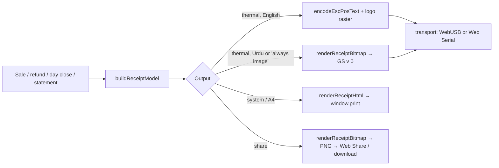

# 06 — Printing

Code lives in `packages/printer` (pure, testable) and `apps/pos/src/print` (device access, settings, job queue).

## 0. Printer-agnostic design (decision D-023)

The shop has **not chosen a printer model yet**, so Bikri must work with any ESC/POS-compatible thermal receipt printer and must not depend on one vendor or model:

- **Two direct transports, both first-class:** WebUSB (printer-class USB device) and Web Serial (USB virtual COM port / RS-232). The setup wizard (§8) tries both and keeps whichever works.
- **Two paper widths, both first-class:** 58 mm and 80 mm (80 mm is the default and the recommendation). Width drives characters per line and raster width:

  | Paper | Chars per line (Font A) | Raster width (dots) | Raster bytes/row |
  |---|---|---|---|
  | 58 mm | **32** | **384** | 48 |
  | 80 mm | **48** | **576** | 72 |

  Both values are editable per device (`kv.printer.chars_per_line`, `kv.printer.dots`) because some 80 mm printers print 42 chars / 512 dots; the test print ruler shows the right value. 44/76/112 mm stay as "advanced" presets (§2).
- **Fallback without any driver work:** browser print (`window.print()` from a hidden iframe) with 58 mm / 80 mm page CSS (§5.3). Works on every browser and every printer that has an OS driver, but cannot kick the drawer and is slower.
- **Only standard ESC/POS commands** (§3). No vendor SDKs, no vendor-specific commands. Optional features that some printers lack (cut, QR, status) are switchable in settings and fail soft.
- **Urdu and any non-ASCII text are printed as raster images** (§6), so the printer needs no Urdu font or code page.
- Requirements: Chrome or Edge (WebUSB and Web Serial are Chromium-only) on a **secure context** — `https://algovyn.com/bikri/` is HTTPS, and `http://localhost` works for development.

### 0.1 Choosing a printer (help text, also in Settings → Printer → "Which printer should I buy?")

Bikri does not recommend a brand or model. When buying, check:

1. **ESC/POS compatible** (stated on the box or spec sheet). This is what Bikri speaks.
2. **USB connection** (USB-B or USB-C). Ethernet/Wi-Fi-only or Bluetooth-only printers are not supported in v1. A model that also offers a serial/virtual COM port driver gives a second way to connect (Web Serial).
3. **80 mm paper** recommended (48 characters per line, room for item names and Urdu). 58 mm works too (32 characters) and is cheaper.
4. **Raster image printing (`GS v 0`)** — needed for the logo and for Urdu; almost all thermal ESC/POS printers support it, but confirm with the test print before relying on Urdu receipts.
5. **Auto-cutter** (optional but useful) and a **cash-drawer port (RJ11/RJ12)** if a drawer will be used.
6. **Windows driver note:** on Windows the vendor driver usually claims the USB device, which blocks WebUSB; then either use Web Serial (if the driver offers a COM port), replace the driver with WinUSB (Zadig), or use browser print. Ask the seller whether a "virtual COM port" driver exists.
7. Bring a laptop with Chrome to the shop if possible and run Bikri's **Test print** before paying.

Urdu is never printed with the printer's own fonts, so "Urdu support" on the printer box does not matter.

## 1. Pipeline



`buildReceiptModel(input, settings) → ReceiptModel` is pure: it turns a sale (with lines, payments, shop, branch, staff, customer) into an ordered list of blocks:

```ts
type Block =
  | { t: 'logo' }
  | { t: 'text'; text: string; align?: 'left'|'center'|'right'; bold?: boolean; size?: 'small'|'normal'|'double' }  // 'small' = Font B (§4.4)
  | { t: 'pair'; left: string; right: string; bold?: boolean }       // label ... value
  | { t: 'item'; name: string; qty: string; amount: string; detail?: string }
  | { t: 'rule'; char: '-'|'=' }
  | { t: 'qr'; data: string }
  | { t: 'feed'; lines: number }
  | { t: 'cut' }
  | { t: 'drawer' };
```

The same model feeds every output, and the Settings live preview renders it with `renderReceiptHtml` at the chosen width.

## 2. Paper widths

| Setting | Characters per line (Font A 12×24) | Printable dots | Raster bytes/line | Notes |
|---|---|---|---|---|
| 44 mm | 24 | 288 | 36 | rare handheld printers |
| 58 mm | 32 | 384 | 48 | common Bluetooth/USB |
| 76 mm | 40 | 512 | 64 | impact printers (raster may be unsupported — then text only) |
| **80 mm (default)** | 48 | 576 | 72 | recommended counter printer |
| 112 mm | 69 | 832 | 104 | wide receipt printers |

Stored per device in `kv.printer.paper_mm`; `chars_per_line` and `dots` can be overridden (some 80 mm printers print 42 chars / 512 dots). Defaults: 80 mm → 48 / 576, 58 mm → 32 / 384. 44/76/112 mm are advanced presets, not tested in v1.

## 3. ESC/POS command reference

All bytes hex. `n` etc. are single bytes.

| Purpose | Bytes | Notes |
|---|---|---|
| Initialise | `1B 40` | Start of every job |
| Code page | `1B 74 n` | `n=0` PC437 (default); Bikri sends ASCII only in text mode |
| Align | `1B 61 n` | 0 left, 1 centre, 2 right |
| Bold on/off | `1B 45 01` / `1B 45 00` | |
| Size | `1D 21 n` | `00` normal, `11` double width+height, `01` double height |
| Font B / Font A | `1B 4D 01` / `1B 4D 00` | Font B (9×17: 42 chars at 58 mm, 64 at 80 mm) for `size: 'small'`; always switch back to Font A after the line. A printer without Font B prints it in Font A, which still fits |
| Line feed | `0A` | |
| Feed n lines | `1B 64 n` | |
| Raster image | `1D 76 30 00 xL xH yL yH d…` | width **bytes** = xL + xH·256 = `ceil(dots/8)` (pad the last byte with white bits), height rows = yL + yH·256; send bands of ≤ 255 rows |
| QR model 2 | `1D 28 6B 04 00 31 41 32 00` | select model |
| QR size | `1D 28 6B 03 00 31 43 n` | module size n = 6 (80 mm) / 4 (58 mm) |
| QR error level | `1D 28 6B 03 00 31 45 31` | level M |
| QR store | `1D 28 6B pL pH 31 50 30 d…` | pL/pH = len(data)+3 |
| QR print | `1D 28 6B 03 00 31 51 30` | |
| Partial cut with feed | `1D 56 42 00` | feeds to cutter then cuts |
| Full cut | `1D 56 41 00` | if partial unsupported |
| Drawer kick pin 2 | `1B 70 00 19 FA` | 25×2 ms on, 250×2 ms off |
| Drawer kick pin 5 | `1B 70 01 19 FA` | setting "Drawer pin" |
| Status (optional) | `10 04 01` | real-time status; only over Serial, ignore if no reply in 300 ms |

## 4. Receipt templates

**Branding is per shop (multi-tenant, [13](13-multi-tenancy.md)).** Every receipt, label and A4 invoice takes its shop name, address, phone, NTN, logo, header and footer only from the active shop's own `shop` / `branches` rows and `kv.logo_bitmap`, passed per call (`ReceiptShop`), never from module-level state or a deployment setting; a till holds one shop's database only (D-073), so there is nothing else to pick from. The only platform branding is the small **"Powered by AlgoVyn"** line at the bottom of customer receipts (§4.4, D-085). Printer settings (`kv.printer`) are per device.

Money format on receipts: `Rs 40,000` when whole rupees, `Rs 3,459.77` when paisa ≠ 0; grouping per `shop.number_grouping`. Text mode uses ASCII only (`x` not `×`, `-` not `·`).

### 4.1 Sale receipt, 80 mm (48 columns)

```
                 [ LOGO raster ]
              BIKRI ELECTRONICS            <- double size, bold, centre
          Shop 12, Hall Road, Lahore       <- address, centre
              Tel: 0300 1234567            <- phone, centre
        Open daily 11am to 10pm            <- receipt_header (if set)
------------------------------------------------
                  SALE RECEIPT
------------------------------------------------
Bill                                  INV-A-1042
Date                           27-10-2026 14:05
Cashier                                   Adnan
Customer                          Bilal Hussain
------------------------------------------------
ITEM                          QTY        AMOUNT
Samsung A15 4/128 Blue          1     Rs 40,000
  Rs 42,000 each - less Rs 2,000
USB-C cable 1m                  2        Rs 900
  Rs 450 each
------------------------------------------------
Subtotal (3 items)                    Rs 40,900
Discount                                -Rs 500
================================================
TOTAL                                 Rs 40,400   <- bold, double height
================================================
Cash                                  Rs 40,400   <- one row per method (if show_payment_details)
Amount tendered                       Rs 41,000
Change                                   Rs 600
------------------------------------------------
Warranty: Samsung A15 - 365 days (till 27-10-2027)  <- lines with sale_lines.warranty_until set
------------------------------------------------
      Shukriya! Phir tashreef laiye.       <- receipt_footer, centre
               [ QR: bill id ]             <- optional setting "QR on receipt"
               Powered by AlgoVyn          <- always; Font B (small), centre, last line (§4.4)
<feed 3><cut><drawer if cash and drawer enabled>
```

Conditional rows: `Sales tax 17%` after Discount when `tax_rate_bp > 0` and the sale is tax-exclusive; for a tax-inclusive sale (`sales.tax_inclusive = 1`) no tax row is added, instead `Includes Sales tax 17%   Rs 1,700` is printed right after `TOTAL`; `Rounding` when `rounding ≠ 0`; `Udhaar (on khata)` plus `Khata balance now` when the bill has an udhaar part; `Card`/`Bank/wallet` rows with reference when used; `Customer` row only when a customer is attached; payment rows are hidden when `show_payment_details = 0`.

Column layout (48): item name cols 1–28 (wrap to further lines, max 2), qty cols 29–33 right-aligned, amount cols 34–48 right-aligned. Detail line indented 2 spaces, max 46 chars. `pair` blocks: label left, value right, at least one space between; if too long, value on the next line right-aligned.

### 4.2 Sale receipt, 58 mm (32 columns)

```
         [ LOGO ]
     BIKRI ELECTRONICS
   Shop 12, Hall Road, Lahore
      Tel: 0300 1234567
--------------------------------
          SALE RECEIPT
--------------------------------
Bill                  INV-A-1042
Date            27-10-2026 14:05
Cashier                    Adnan
--------------------------------
Samsung A15 4/128 Blue
 1 x 42,000 -2,000     Rs 40,000
USB-C cable 1m
 2 x 450                  Rs 900
--------------------------------
Subtotal (3)           Rs 40,900
Discount                 -Rs 500
================================
TOTAL                  Rs 40,400
================================
Cash                   Rs 40,400
Tendered               Rs 41,000
Change                    Rs 600
--------------------------------
 Shukriya! Phir tashreef laiye.
       Powered by AlgoVyn
```

58 mm always uses the two-line item format: name line (wrap at 32), then ` <qty> x <unit price>[ -<discount>]` left and amount right.

### 4.3 Other documents

| Document | Title line | Differences |
|---|---|---|
| Refund receipt | `REFUND RECEIPT` | Shows original bill no and date, refunded lines with qty, exact amount, rounding, money paid back and method (omitted when 0), `Taken off khata` and `Khata balance now` when there is an udhaar part, reason |
| Void notice | `BILL CANCELLED` | Original bill no, reason, replacement bill no if reissued |
| Day close summary | `DAY CLOSE` | Device, staff, period, each formula line, expected, counted, difference, denominations |
| Customer statement | `KHATA STATEMENT` | Customer name/phone, period, each entry (date, description, +/−, balance), closing balance. Usually shared as image, printable |
| Supplier payment slip | `PAYMENT TO SUPPLIER` | Supplier, amount, method, note, balance after |
| Supplier return slip | `RETURN TO SUPPLIER` | Supplier, linked delivery no, lines with qty and credit, total credit, money received back and method, reason, balance after |
| Barcode labels | — | Not ESC/POS: printed through the browser print dialog on a label printer or A4 sticker sheet, Code 128, see [screens/20](screens/20-barcode-labels.md) |
| Test page (no "Powered by" line) | `BIKRI TEST PRINT` | Paper width ruler `123456789012…`, bold/double sample, an Urdu raster line `اردو ٹیسٹ پرنٹ`, QR, "If the drawer opened, the drawer works", then cut |

### 4.4 "Powered by AlgoVyn" line (D-085)

Owner decision (27 Oct 2026, supersedes the "no vendor branding" part of REQ-B03): every **customer receipt** ends with one small line `Powered by AlgoVyn`, centred, after the footer and the optional QR, before the feed and cut.
- Documents: sale receipt (also reprints and the reissued bill of a void-and-reissue), refund receipt, void notice, and their shared image and A4 versions. Not on internal slips (day close, supplier payment and return slips), barcode labels or the test page.
- ESC/POS: block `{ t: 'text', text: 'Powered by AlgoVyn', align: 'center', size: 'small' }` → `1B 61 01`, `1B 4D 01`, text, `0A`, `1B 4D 00`, `1B 61 00`. Same on 58 mm and 80 mm (18 characters fit every width).
- Raster receipts (Urdu, §6): the same line drawn in Inter at about 70 % of the body size, centred, as the last row of the bitmap.
- Browser print (`window.print` fallback, §5.3) and the Settings preview: `<p class="powered-by">Powered by AlgoVyn</p>` with `.powered-by { text-align: center; font-size: 8px; margin-top: 2mm }` (58 mm and 80 mm CSS) and 9 pt on A4.
- Always the English words "Powered by AlgoVyn" (the company name, spelled exactly so), in every receipt language. Not a shop setting in v1: Settings → Receipt shows it in the preview with the note "Added by AlgoVyn".
- Golden files: the T-019 byte snapshots (`sale-basic` at 58 and 80 mm, §10) and the E2E receipt text snapshot include this line.

## 5. Transports

### 5.1 WebUSB (Windows/Linux/ChromeOS/macOS, Android with USB OTG)

```ts
// Example only
const device = await navigator.usb.requestDevice({ filters: [{ classCode: 7 }] }); // printer class
await device.open();
if (device.configuration === null) await device.selectConfiguration(1);
const iface = device.configuration!.interfaces.find(i => i.alternates[0].interfaceClass === 7)!;
await device.claimInterface(iface.interfaceNumber);
const ep = iface.alternates[0].endpoints.find(e => e.direction === 'out' && e.type === 'bulk')!;
for (const chunk of chunks(bytes, 4096)) await device.transferOut(ep.endpointNumber, chunk);
```

- Store `vendorId`, `productId`, `serialNumber` in `kv.printer`; on startup reconnect with `navigator.usb.getDevices()` (no prompt).
- Many cheap ESC/POS printers report a vendor-specific class (`0xFF`) instead of printer class 7, so the picker shows a **"Show all USB devices"** button next to the printer-class picker from the start, and the wizard uses `filters: []` automatically if the first picker was cancelled with nothing listed. After `open()`, pick the first interface with a bulk OUT endpoint if none has class 7.
- **Windows:** the vendor printer driver claims the device, so `claimInterface` fails with `SecurityError`/`NetworkError`. The setup screen explains: either install the WinUSB driver for the printer with Zadig (link in help), or use Web Serial (many printers expose a virtual COM port), or use System printing. Trade-off to state in the help: replacing the driver with WinUSB makes the printer **disappear from Windows printing**, so System printing (browser fallback) no longer works for that printer; choose either WebUSB (WinUSB driver) or Windows driver + Web Serial/System printing.
- **Linux:** the kernel `usblp` driver claims USB printers; the help text gives a udev rule granting the user access to the printer's vendor ID and a modprobe line to blacklist (or unbind) `usblp`, otherwise `claimInterface` fails.

### 5.2 Web Serial (USB-serial / virtual COM / RS-232)

```ts
const port = await navigator.serial.requestPort();
await port.open({ baudRate: 9600, dataBits: 8, stopBits: 1, parity: 'none', flowControl: 'none' });
const writer = port.writable!.getWriter();
await writer.write(bytes); writer.releaseLock();
```

Baud choices: 9600 (default), 19200, 38400, 115200; flow control none (default) or hardware (offered by the wizard if prints come out garbled or truncated). Remember the port via `navigator.serial.getPorts()` (store `usbVendorId`/`usbProductId` from `port.getInfo()` to pick the right port on startup).

### 5.3 System printing (fallback; also for A4/office printers)

- Render `renderReceiptHtml(model, { widthMm })` into a hidden iframe and call `iframe.contentWindow.print()` (i.e. `window.print()` of the receipt document).
- CSS by paper width (`apps/pos/src/print/receipt-80.css`, `receipt-58.css`):
  ```css
  /* 80 mm */ @page { size: 80mm auto; margin: 0 } body { width: 72mm; margin: 0 4mm; font: 12px/1.35 'JetBrains Mono', monospace }
  /* 58 mm */ @page { size: 58mm auto; margin: 0 } body { width: 48mm; margin: 0 5mm; font: 10px/1.35 'JetBrains Mono', monospace }
  img.logo { max-width: 60%; } .urdu { font-family: 'Noto Nastaliq Urdu'; direction: rtl; line-height: 1.9 }
  ```
  Urdu prints as real text here (the OS driver rasterises it), so no bitmap step is needed. A4: `@page { size: A4; margin: 15mm }` with a proper invoice layout (shop block, table of lines, totals block).
- For silent printing on the counter PC: launch Chrome with `--kiosk-printing` and set the thermal printer as the Windows default with paper size "80 × 297 mm" or "Receipt". Settings → Printer → System tab shows these steps.
- Drawer kick is impossible via system printing unless the Windows driver has "open drawer after print" — the help text says so.

### 5.4 Bluetooth

v1 does not implement a Bluetooth transport. Android users use System printing with the printer vendor's print service app, or a USB OTG cable with WebUSB. (Web Bluetooth only reaches BLE printers; most cheap printers are classic SPP.) Revisit in v2.

## 6. Logo and Urdu raster rendering

- Before drawing, `await document.fonts.load('24px "Noto Nastaliq Urdu"')` (and Inter); canvas text silently falls back to a system font if the web font is not loaded yet. Render on the main thread's `OffscreenCanvas` (fonts loaded in the document are available there; a worker would need its own `FontFace`).
- `renderReceiptBitmap(model, { dots, font })` draws the receipt on an `OffscreenCanvas` `dots` wide: Inter for Latin, Noto Nastaliq Urdu for Urdu (line height 1.9 for Nastaliq), black on white, RTL text aligned right.
- Logo (REQ-B03): uploaded in Settings → Receipt; on device it is converted to greyscale, scaled to max 60% of `dots` width and max 160 px height, then **Floyd–Steinberg dithered** to 1-bit and cached in `kv.logo_bitmap` (Uint8Array + width/height) so printing does not re-process it.
- Text rasters use a simple threshold at 50% luminance (crisper than dithering).
- 1-bit conversion: each row packed MSB-first, 1 = black, row length = `dots/8` bytes. Sent as `GS v 0` bands of at most 255 rows.
- Mode rules: `language = 'ur'` → whole receipt as image. `language = 'en'` or `'roman-ur'` → text mode + logo raster; any line containing non-ASCII characters (e.g. an Urdu product name) is rendered as a raster line in place.
- Performance target: 80 mm Urdu receipt with 5 items rendered + sent in < 2.5 s on a 4-year-old i3.

## 7. Cash drawer

- Settings → Printer → Drawer: "Open drawer for cash sales" (default on), pin 2 / pin 5.
- Drawer bytes are appended after the cut for: cash sales (any cash portion), cash refunds, pay-ins/pay-outs, and F9 "Open drawer" (permission `drawer.open`, logged `drawer_open`).
- Card/bank-wallet/udhaar-only sales do not open the drawer.

## 8. Printer setup and test print (per device)

Settings → Printer (layout and copy in [screens/17](screens/17-settings.md#printer)) has tabs **USB**, **Serial**, **System**, **A4** and a **Set up printer** wizard that is also offered from the setup wizard's last step and from the first failed print.

Wizard steps:

1. **Paper width:** 80 mm (recommended) or 58 mm, with a picture of each roll; sets chars/line 48/32 and dots 576/384.
2. **Connection:** `USB (recommended)` → WebUSB `requestDevice({ filters: [{ classCode: 7 }] })`, with "Show all USB devices" if nothing appears; `Serial / COM port` → `navigator.serial.requestPort()` + baud; `No direct connection` → System printing. Browsers without WebUSB/Web Serial (Firefox, Safari) see only System printing, with a note to use Chrome or Edge.
3. **Test print:** sends the test page (§4.3): ruler `1234567890…` exactly `chars_per_line` wide, bold/double sample, logo, Urdu raster line, QR, cut, then drawer kick if enabled. The screen asks three yes/no questions: *Did the ruler fit on one line?* (no → offer 42 chars / 512 dots for 80 mm, or the 58 mm preset), *Is the Urdu line readable?* (no → raster unsupported: switch receipt language to English and note it), *Did the paper cut / drawer open?* (no → set cut to none / check drawer pin 2↔5).
4. **Save:** stores `kv.printer = { transport: 'usb'|'serial'|'system', paper_mm, chars_per_line, dots, usb?: {vendorId, productId, serialNumber}, serial?: {usbVendorId, usbProductId, baudRate, flowControl}, cut: 'partial'|'full'|'none', qr: boolean, drawer_pin: 2|5, status_query: boolean }`.

If a USB `claimInterface` fails on Windows, the wizard explains the driver issue (§5.1) and offers Serial or System printing instead of failing.

Other fields: auto-print after sale (default on), copies (1–3), print logo (on), QR on receipt (off), drawer pin, cut type, preview at the chosen width.

## 9. Print job lifecycle and errors

REQ-B15: the sale is committed to IndexedDB **before** any print attempt.

1. After the sale transaction commits, create `print_jobs { id, sale_id, kind: 'sale', status: 'queued' }` in a **separate** Dexie transaction (best effort: if it fails, the sale is still saved and can be reprinted from Sales).
2. Print service picks jobs FIFO; status `printing`; timeout 8 s per job.
3. Success → `done`. Failure → `failed` with error code (`NO_PRINTER`, `PERMISSION`, `DISCONNECTED`, `TIMEOUT`, `PAPER_OUT` if status known).
4. UI on failure: a non-blocking toast "Receipt didn't print — <reason>" with **Retry** and **Print later**; the success sheet stays usable for the next sale.
5. Settings → Printer → Recent prints lists the last 50 jobs with Retry.
6. Reprint from Sales → bill detail at any time; reprints print `REPRINT` under the title.

## 10. Tests

- `escpos.test.ts`: byte-exact snapshots for the 80 mm and 58 mm sale templates above (fixture sale in `e2e/fixtures/sale-basic.json`), ending with the Font B "Powered by AlgoVyn" line (§4.4); the day-close template snapshot has no such line.
- `layout.test.ts`: long names wrap, amounts right-align, pair overflow, 24/32/40/42/48/69 widths.
- `raster.test.ts`: 1-bit packing of a known 16×2 bitmap; band splitting at 255 rows.
- `transports.test.ts`: fake `navigator.usb` and `navigator.serial` record bytes; both produce identical bytes for the same job; chunking ≤ 4096 bytes; timeout → `TIMEOUT`.
- Manual hardware checklist (in [10 §6](10-testing.md#6-manual-hardware-checklist-before-each-release)): run on the printer the shop actually buys — WebUSB, Web Serial (if available), System printing at 58 and 80 mm, drawer pin.
