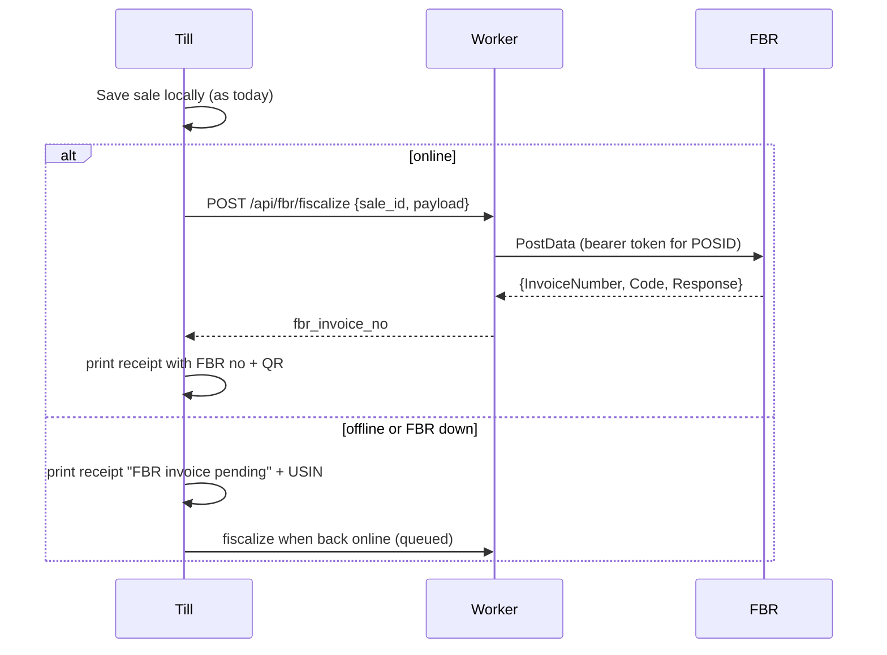

# 12 — FBR POS integration (optional, later module)

Status: **not in v1**. Needed only if the shop becomes a Tier-1 retailer under the Sales Tax Act (or opts in). This document fixes the design so v1 does not paint us into a corner. Before implementing, re-read the current FBR documents — field names, URLs and fees below were checked on 26 Oct 2026 against public FBR/PRAL material and may change:

- FBR: "Sales Tax General Order — Tier-1 Retailers – Integration with FBR's POS System" (fbr.gov.pk).
- PRAL technical document for the IMS software fiscal component and the cloud Web API.

## 1. What FBR requires (summary)

1. Register each POS (per branch/till) on the FBR IRIS portal → a numeric **POSID** per till.
2. For every invoice, in real time, send invoice data to FBR and receive a unique **FBR invoice number**.
3. Print the FBR invoice number and a **QR code** (encoding the FBR invoice number) plus the FBR POS logo on the receipt.
4. Refunds/returns are reported as their own invoice type (credit note).
5. Two integration styles: (a) a local "IMS fiscal component" Windows service at `http://localhost:8524/api/IMSFiscal/GetInvoiceNumberByModel`; (b) **cloud Web API** `POST https://gw.fbr.gov.pk/imsp/v1/api/Live/PostData` (sandbox `https://esp.fbr.gov.pk:8244/FBR/v1/api/Live/PostData`) with a bearer token issued per POS.

Bikri uses **(b) cloud Web API from the Worker** — no Windows service, works for phone tills too.

## 2. Payload mapping

| FBR field | Bikri source |
|---|---|
| `InvoiceNumber` | empty on request |
| `POSID` | `devices.fbr_pos_id` (new column, v2) |
| `USIN` (unique sale invoice number of the POS) | `sales.invoice_no` (e.g. `INV-A-1042`) |
| `DateTime` | `sales.created_at` in Asia/Karachi, `yyyy-MM-dd HH:mm:ss` |
| `BuyerNTN`, `BuyerCNIC`, `BuyerName`, `BuyerPhoneNumber` | customer fields when present (new optional `customers.cnic`, `ntn`) |
| `TotalSaleValue` | `subtotal − bill_discount` in rupees (2 decimals) |
| `TotalTaxCharged` | `tax` |
| `Discount` | `item_discount_total + bill_discount` |
| `FurtherTax` | 0 (unless buyer unregistered rules apply — owner config) |
| `TotalBillAmount` | `total` |
| `TotalQuantity` | Σ qty (decimal) |
| `PaymentMode` | 1 cash, 2 card, 3 gift voucher, 4 loyalty, 5 mixed, 6 cheque (FBR codes); udhaar → 1 per FBR guidance to be confirmed |
| `InvoiceType` | 1 new sale, 2 debit note, 3 credit note (refund) |
| `RefUSIN` | original invoice for refunds |
| `Items[]` | per line: `ItemCode` = SKU, `ItemName`, `Quantity`, `PCTCode` (new `products.pct_code`), `TaxRate`, `SaleValue` (line revenue), `TaxCharged` (`tax_alloc`), `TotalAmount` (`line_final`), `Discount`, `InvoiceType` |

All conversions use the integer values from [07](07-money-rules.md) and format with 2 decimals only at the boundary.

## 3. Flow (offline-first compatible)

- Data: new append-only table `fbr_submissions (id, sale_id|refund_id, attempt, request_json, response_json, fbr_invoice_no, status 'ok'|'error', created_at)`; `sales.fbr_invoice_no` is a derived cache from the latest ok row.
- Tokens per POSID stored as Worker secrets (`FBR_TOKEN_<POSID>`) or encrypted in D1; never on tills.
- Timeout 5 s; then fall back to pending. Retries with backoff; failures visible in Admin.
- The Worker call is one subrequest — within the free plan's 50 subrequests and the request CPU budget (network wait is not CPU).
- If FBR requires a strictly real-time fiscal number for every printed receipt, a strict mode blocks printing until fiscalized (sale still saved, REQ-B15) — **open question** to confirm with FBR/consultant.
- The FBR POS service fee (historically Rs 1 per invoice, collected from the customer) is a setting `fbr_service_fee` added as a separate non-taxable line when enabled — confirm the current amount.

## 4. Receipt changes

Below totals: FBR logo (raster, from FBR's official artwork, owner-provided), "FBR Invoice # 110014ABCD…", QR (ESC/POS `GS ( k` model 2, size 6, or raster fallback), and the line "Verify this invoice through FBR TaxAsaan app or SMS at 9966" (text to be confirmed with current rules).

## 5. Work items (when started)

1. Schema migration (columns above + `fbr_submissions`).
2. Settings → FBR (owner): enable, environment sandbox/production, POSID per device, PCT code defaults per category.
3. Worker route `/api/fbr/fiscalize` + queue processing on push.
4. Receipt template block.
5. Sandbox certification run (FBR provides test POSID/token).
6. Reports: FBR status per bill, pending list, CSV export.
