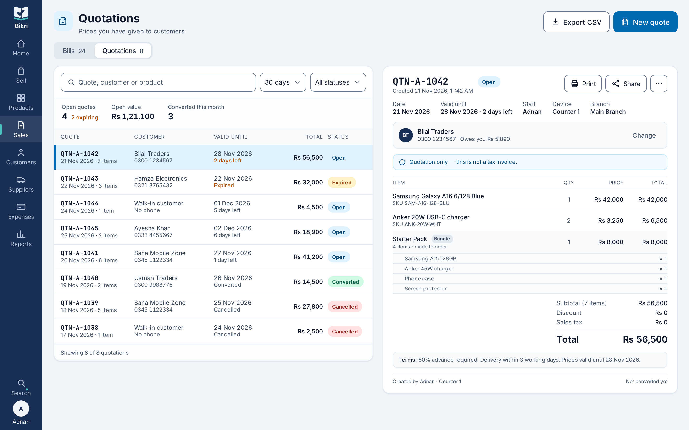
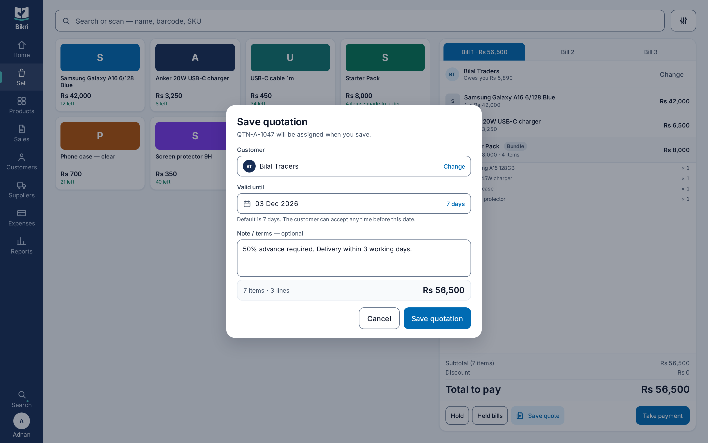
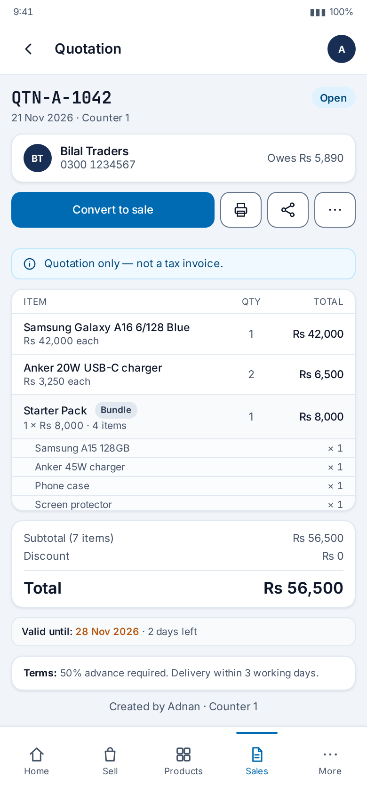
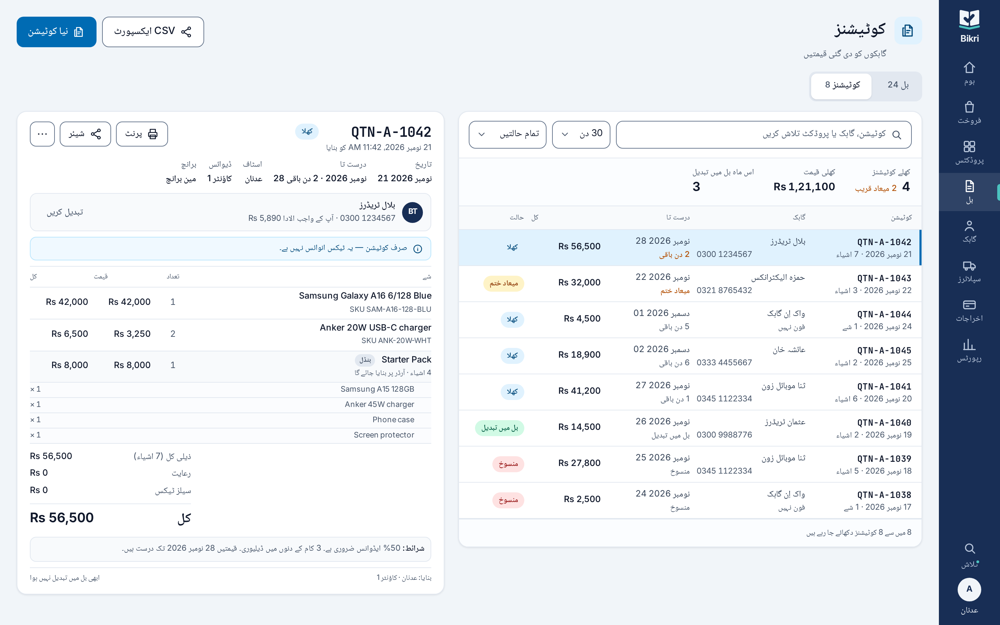
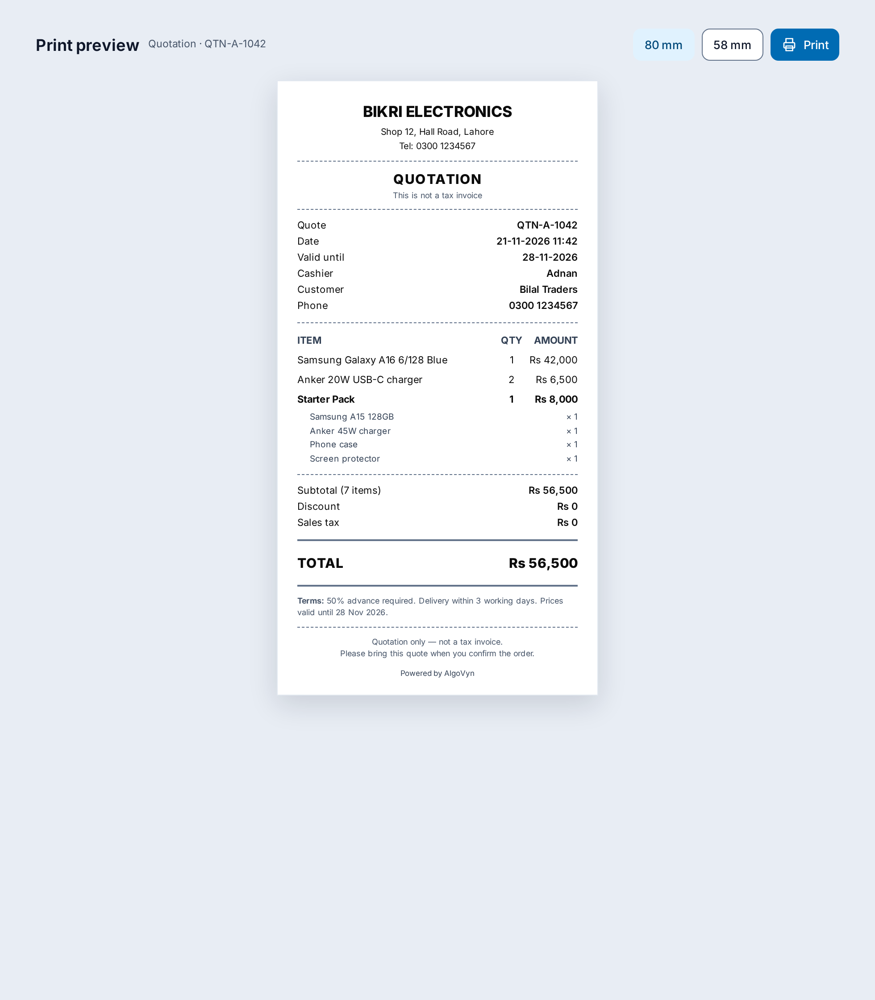

# 21 — Quotations

**Routes** `/quotations`, `/quotations/:id`. The `Quotations` tab on Sales opens `/quotations`; the Sales rail item stays active. At ≥ 1280 px the list and the selected quote share one master–detail workspace; below 1280 px the quote is a full page with a back arrow.

**Permissions.** Creating, editing, converting and cancelling a quotation requires only `sale.create` (anyone who can sell can quote). Discounts and price overrides use the Sell rules (`sale.discount`, `staff.max_discount_bp`, `catalog.edit`); the override dialog and audit rows are the same as on a sale. A below-cost line is only a warning on the quote and is enforced by `sale.below_cost` when the quote is converted. The list's `Export CSV` requires `export.data`. A quote's `Print`, `Share` and `PDF` only require access to the quote; the detail has no CSV action. A cashier without `report.view` sees open quotes of any date (so they can convert one) and converted/cancelled quotes from today only. A read-only shop can list, open, print, share and PDF quotations; `New quote`, `Edit`, `Save`, `Convert` and `Cancel` are hidden or disabled with the read-only message.

A quotation is a **non-financial sales document**. It stores the prices and terms offered to a customer. It never moves stock, never creates a payment or ledger row, never affects udhaar or the day close, and is not a sale until it is converted. The quote number is always separate from the invoice number.

## Reference

There is no quotation screen in the Dukaan reference set. The list/detail structure follows [Sales history](10-sales-and-bill-detail.md) and the Sell cart; the visual language is the Algovyn design system in [08](../08-ux-guidelines.md). Do not copy any third-party quotation design.

## Design mockups

These are static design renders for review (not implemented screenshots). The source of truth is the written spec below.

**Desktop: Sales → Quotations, list and selected quote**

**Sell: Save quotation dialog**

**Phone: quotation detail**

**Urdu (RTL): list and detail**

**80 mm quotation slip**

## Lifecycle

| State | Meaning | Actions |
|---|---|---|
| **Open** | The customer has a live price offer. Editable; the default for every new quote. | Edit, Duplicate, Print, Share, PDF, Convert, Cancel |
| **Expired** (derived) | `status = 'open'` and `valid_until` is before today in the shop time zone. Not stored, so no cron is needed. | Same as Open, with an expiry warning; conversion asks whether to re-price |
| **Converted** | A sale was completed from this quote. Terminal. | View, Print, Share, PDF, open the sale; Duplicate |
| **Cancelled** | Staff withdrew the offer with a reason. Terminal. | View, Print, Share, PDF, Duplicate |

A quote is **never** deleted from history. Discarding an unsaved draft simply leaves the cart; discarding a saved open quote uses `Cancel` with a reason. `Duplicate` creates a new open quote with a new number, same lines/customer/terms and a fresh default validity; it does not reuse the old number.

## Layout

### Sales tabs

The Sales page gains a compact segmented tab row under its page header:

`Bills (n)` | `Quotations (n)`

`Bills` is the existing [Sales history](10-sales-and-bill-detail.md). `Quotations` opens `/quotations` and uses the same page shell, rail and responsive rules. The tab counts are the rows in the current date range, not lifetime totals. Selecting a quote opens `/quotations/:id`; at ≥ 1280 px it appears beside the list, below 1280 px it replaces the list.

### Quotations list

1. **Page header**: pastel quote icon, title `Quotations`, subtitle “Prices you have given to customers”. `New quote` is the one filled primary action, with `Export CSV` quiet beside it.
2. **Date range** (shared with Bills, remembered on this device, default `Today`): Today, Yesterday, 7 days, 30 days, This month, Custom. Dates after today are clamped. It filters both the list and the summary.
3. **Surface**: one list surface containing the toolbar, summary strip and rows, never three separate cards.
4. **Toolbar**: search (quote no, customer name/phone, product name) with `F2`; status (All, Open, Converted, Expired, Cancelled); sort (Newest first, Oldest first, Total highest, Total lowest, Valid until soonest). The search is debounced at 0 ms because it reads Dexie locally.
5. **Summary strip**: `Open quotes` (count), `Open value` (Σ open totals), `Converted this month` (count and value) and `Expiring soon` (count in warning colour when non-zero; `valid_until` within 7 days). Figures respect the salary/privacy mask ([08 §4](../08-ux-guidelines.md#4-language-rtl-and-numbers)).
6. **Rows**: quote no (mono), created date + item count, customer + phone, valid until + a small `n days left` / `Expired` / `Converted` / `Cancelled` line, total, status pill. The status pill is the only colour-coded element; `Open` is primary-subtle, `Expired` warning, `Converted` success, `Cancelled` danger-subtle. The selected row uses the primary-subtle background and a 3 px start-edge indicator. No infinite spinner or list footer count; the list and summary carry the counts.
7. **Empty state**: “No quotations yet” + `New quote`. No results: “Nothing matches ‘xyz’” + `Clear filters`. Read-only: the list is available, but the New/Edit/Convert/Cancel actions are not.

### Quote detail

**Header (record header, not the page header)**

- Quote icon, quote number in mono (`QTN-A-1042`), status pill.
- Created date/time, valid-until date with `n days left` or `Expired`, staff, device, branch.
- Actions: `Convert to sale` (filled primary; hidden when converted/cancelled), `Print`, `Share` and `PDF` (quiet), and a `More` menu with `Edit`, `Duplicate` and `Cancel`. On phones `Print` and `PDF` move into the `More` menu; the row keeps `Convert`, `Share` and `More`. The `More` menu keeps `Duplicate` for converted/cancelled quotes.
- A green `Converted to INV-A-1048` bar with the invoice number itself linking to the sale, when applicable.

**Body**

1. **Customer strip**: avatar/initials, customer name and phone, current khata balance if the customer still exists, `Change` to edit the customer on an open quote. Walk-in shows “Walk-in customer · No phone”. The quote stores its own name/phone snapshot, so renaming or deleting the customer later never changes a printed quote.
2. **Notice banner**: `Quotation only — this is not a tax invoice.` For an expired quote, a warning banner replaces it: `This quotation expired on 22 Nov 2026. Convert at today's prices, or use the quoted prices with a manager approval.`
3. **Lines table**: item, qty, unit price, discount, line total. Bundle groups use the same block as a bill: one bundle header with a neutral `Bundle` pill, then the component names and total quantities, with no component prices. Quick-sale lines show their typed name; deleted products remain readable from the snapshot. Line notes (serial/IMEI) appear under the name.
4. **Totals**: `Subtotal (n items)`, `Item discounts`, `Discount`, `Sales tax` (or the inclusive line under the total), `Rounding` when non-zero, and `Total`. These are the values stored on the quote, not recomputed from today's prices.
5. **Terms/notes**: the optional note, printed and shared with the quote.
6. **Footer**: created by, device, and the conversion state.

There are **no** payments, refunds, change, udhaar, stock or day-close sections on a quotation. A quotation is not a bill.

## New quote and save dialog

`New quote` opens Sell in **quote mode** with an empty cart (the first empty cart tab; if all three tabs have items, ask which tab to replace): banner above the cart tabs reads `New quotation · number assigned when you save`, and the primary action is `Save quote`. `Save quote` is also available as a quiet action on the normal Sell cart; pressing it opens the same dialog with the current cart.

**Save quotation dialog**

| Field | Rules |
|---|---|
| Customer | Optional. Defaults to `Walk-in customer`. Search by name/phone; `+ New customer` uses the normal customer dialog. The chosen name and phone are snapshotted on the quote. |
| Valid until | Required date, default today + 7 days, minimum today, maximum today + 365 days, shop time zone. The customer can accept any time up to and including this date. |
| Note / terms | Optional, 0–500 characters. Printed and shared; not a substitute for the receipt footer. |
| Summary | Item count and total from the current cart; read-only. |
| Actions | `Cancel` (nothing written) and `Save quotation` (primary). `Ctrl+S` saves. |

Validation is the Sell validation: 1–60 lines, no empty quote, quantity/price/discount rules, bundle groups complete, 60-line limit. A below-cost line shows the red warning but **does not block saving a quote**. A discount above the cashier limit or a price below the catalogue price asks for the normal manager override before the quote is saved. Credit limits and stock are not checked as blockers; a quote is not a sale.

On save:

1. Assign `QTN-<device_code>-<seq>` from the device quote counter (never the invoice counter).
2. Write `quotations` + `quotation_lines` + the audit row in one Dexie transaction with the outbox ops.
3. Clear the cart tab and show a toast: `Quote QTN-A-1047 saved · Open`.
4. If the quote was edited from an existing quote, return to its detail instead of clearing the screen.

## Quote mode in Sell

When the cart was opened from `New quote`, `Edit` or `Duplicate`, Sell shows a quote banner above the cart tabs:

`Editing quotation QTN-A-1042 · valid until 28 Nov 2026` with `Cancel edit` and, for a new quote, `New quotation · number assigned when you save`.

- The cart is the normal Sell cart: search, scanning, quantities, prices, line/bill discounts, notes, bundles and hotkeys behave exactly as in a sale.
- `Save quote` is the primary action in quote mode. `Take payment` is hidden in this mode so a cashier cannot accidentally create a sale while they think they are saving a quote. To sell the same cart, save it first, then use `Convert to sale`; or cancel quote mode and use the normal Sell cart.
- Cancel edit returns to the quote detail (existing quote) or clears the quote-mode cart (new quote) after confirming when there are lines.
- The quote uses the current cart prices and taxes. Editing an open quote is allowed even after it was printed; the detail shows the last updated time, and `Print` prints the current version.
- Changing a product price, tax setting or bundle recipe later does not change a saved quote. Conversion revalidates against today's catalogue and shows the difference.

## Convert to sale

`Convert to sale` is the primary action on an open or expired quote. It opens Sell with the quote lines copied into the first empty cart tab (if all three tabs have items, ask which tab to replace) and a banner:

`From quotation QTN-A-1042 · valid until 28 Nov 2026`

- The cart line prices are the **quoted prices**. A line whose current catalogue price differs shows a `Quoted` badge and `Now Rs X`; if the quoted price is below today's catalogue, the normal `catalog.edit`/override rule applies, exactly like a manual price in Sell. A price approval given when the quote was saved is not a sale approval; the conversion re-runs the sale checks.
- If the quote is **expired**, a confirmation appears before the cart opens: `This quotation expired on 22 Nov 2026. Convert at today's prices?` `Convert at today's prices` is primary. `Use quoted prices` is available only to a user with `catalog.edit` or after the normal manager override, and writes `audit_log quote_expired_price_used`.
- Payment is the normal Pay flow. On `Done`, the sale and the quote status update are written in the same Dexie transaction: the quote becomes `converted`, `converted_sale_id` points at the sale, `converted_at` is set, and the sale detail shows a green `Quotation QTN-A-1042` bar linking back (a reverse lookup on `quotations.converted_sale_id`).
- Abandoning the cart writes nothing and leaves the quote open.
- Converting does not reserve stock. Normal stock warnings and negative-stock rules apply; a quote can be converted after stock changed.
- If two tills convert the same quote offline, both sales are real and both are accepted. The quote points to the latest conversion; the first is still visible in audit and on its own bill. Never reject a sale because a quotation status changed.
- Converted and cancelled quotes cannot be edited or converted again; use `Duplicate` for a new offer.

## Print, share and export

- **Print** uses a new quotation template in `packages/printer`: `QUOTATION` title, quote no, date, valid until, customer, staff, item lines (the same bundle header/component block as a sale), totals, terms, and `This is a quotation, not a tax invoice` plus `Prices valid until <date>`. There are no payment, change, udhaar or `Cash` rows.
- 58 mm and 80 mm, ESC/POS, raster/Urdu and the browser-print fallback follow [06](../06-printing.md). The slip ends with the standard `Powered by AlgoVyn` line because it is a customer-facing document.
- `Share` renders the quotation slip to a PNG and opens the OS share sheet with that file plus a text message; with a customer phone it downloads the PNG and opens the same `https://wa.me/<number>?text=` link as bills. `PDF` downloads a one-page PDF of the same rendered slip. There is no public quote link or online acceptance page in v1.2.
- `Export CSV` exports the current filtered list with the header in [screens/README](README.md#csv-headers-req-b02-t-049); the detail has no CSV action. The full shop export/backup includes `quotations` and `quotation_lines` like every other synced table.
- Print/share/export work offline and in a read-only shop. A failed print is retried from the print queue; the quote is already saved.

## Fields and validation

| Field | Type / rule |
|---|---|
| `quote_no` | Generated on save: `QTN-<device_code>-<seq>`. Unique per tenant; never editable; never an invoice number. |
| `valid_until` | `YYYY-MM-DD` shop business date. Required; default `business_date + 7`; same-day allowed; max +365 days. |
| `customer_name` / `customer_phone` | Snapshots (max 60 / 30 chars), default `Walk-in customer` / empty. |
| Lines | 1–60 lines; qty in milli-units; unit price and discounts as a sale; bundle lines follow the sale bundle rules. |
| `note` | 0–500 chars; printed. |
| Status | `open`, `converted`, `cancelled`; `expired` is derived from `valid_until` and today, never stored. |
| Cancellation reason | 1–120 chars; required for `Cancel`. |
| Conversion | Only an open or expired quote; `converted_sale_id` must point to a sale in the same action (or an existing sale for a replay). |

## Permissions and read-only

| Action | Requirement |
|---|---|
| See open quotes, open a quote, convert | `sale.create` |
| See converted/cancelled quotes older than today | `report.view` (cashier sees today only) |
| Create, edit, duplicate, save | `sale.create` |
| Discount, price override | normal Sell rules (`sale.discount`, `staff.max_discount_bp`, `catalog.edit`) |
| Below-cost line on conversion | normal Sell rule (`sale.below_cost` or override); saving the quote only shows the warning |
| Cancel an issued quote | `sale.create` (anyone who can quote) |
| Export CSV (list) | `export.data` |
| Print, share, PDF | anyone who can open the quote |
| Read-only shop | view, print, share and export only; all writes blocked by the read-only guard |

No new permission key is added in v1.2. If a shop wants to prevent cashiers from creating quotes, the owner can grant a dedicated `quote.create` key later; that is a separate decision.

## States

- **Empty list**: quote icon, “No quotations yet”, `New quote`.
- **No search results**: “Nothing matches ‘xyz’” + `Clear filters`.
- **Offline**: everything on this screen works; the sync badge shows waiting changes. Creating, editing and converting queue normally.
- **Read-only**: list/detail/print/share/export work; New/Edit/Save/Convert/Cancel are hidden or disabled with `tenant.readOnly.blocked`.
- **Expired**: warning banner; Convert still available with the re-pricing confirmation.
- **Converted**: terminal; the sale link is shown; Edit/Convert/Cancel hidden.
- **Cancelled**: terminal; reason shown in the detail.
- **Loading**: skeleton rows for the list; never block the screen on a spinner. A quote opened from a deep link loads from Dexie, so it works offline.
- **Deleted product/customer**: the snapshot remains readable; conversion may show “Product no longer available — remove it or use a quick-sale line”.

## Hotkeys

| Key | Action | Scope |
|---|---|---|
| `N` | New quote | Quotations list |
| `F2` / `Ctrl+F` | Focus search | Quotations list |
| `↑` / `↓` | Move selection | Quotations list |
| `Enter` | Open selected quote | Quotations list |
| `P` | Print | Quote detail |
| `C` | Convert to sale | Quote detail |
| `E` | Edit | Quote detail |
| `Ctrl+S` | Save quotation | Save dialog / quote mode |
| `Esc` | Close dialog / back | Global |
| `Ctrl+Shift+4` | Sales (and the Quotations tab stays where it was) | Global rail |

## Acceptance criteria

1. From Sell, `Save quote` with a customer, `Valid until` and terms saves the cart as an open quote, clears the cart and shows a toast with `Open`; the quote appears in the list and detail with the exact lines, quantities, prices, discounts, customer and terms.
2. Saving a quote writes no `stock_movements`, `payments`, `ledger_entries`, `party_balances` or day-close rows; stock and every report are unchanged. The audit log records `quote_create`/`quote_change`.
3. A quote number is `QTN-<device_code>-<seq>` and is independent of the invoice sequence. Two devices never collide; a restore/re-enrolment never reuses a quote number.
4. The detail shows `Quotation only — this is not a tax invoice`; no payment, refund, change, udhaar or stock sections.
5. `Print` at 58 mm and 80 mm shows `QUOTATION`, the quote number, valid until, customer, item lines and totals, with the bundle block printed exactly like a sale (one bundle header, component quantities, no component prices); no payment rows.
6. `Convert to sale` opens a prefilled cart with a `From quotation QTN-A-1042` banner; completing a cash sale creates a normal sale and marks the quote converted in the same transaction; the bill detail links back to the quote, and the quote links to the invoice.
7. Converting twice/closing the tab: abandoning the cart leaves the quote open; a double-click on `Done` never creates two sales.
8. An expired quote shows `Expired`; `Convert` asks for re-pricing, `Convert at today's prices` works, and `Use quoted prices` requires `catalog.edit`/override and writes the audit row.
9. A quote with a bundle stores the component snapshot; printing shows one bundle header and the component names/quantities; converting reuses the held-bill bundle revalidation and never creates a synthetic bundle sale line.
10. Any user with `sale.create` can create, edit, convert and cancel a quote; a user without it cannot. Read-only hides all writes; print/share/export still work.
11. Offline: create, edit, reload, print and convert all work; after reconnect the quote and its conversion sync; a second till receives the quote and can convert it.
12. Two tills edit the same quote offline: the field merge is recorded; a converted/cancelled quote cannot be edited; two offline conversions do not lose either sale.
13. The Quotes tab/route is available in the same three languages and RTL; numbers remain Western digits and LTR; the layout works at 1280×800 and 390×844.
14. The list `Export CSV` has the documented header and only the current filter; `Share` produces the quotation as a PNG and `PDF` downloads the same slip; the full export/restore includes `quotations`/`quotation_lines` and the isolation suite has colliding quote ids across two tenants.
15. The quotation list/detail never changes Sales reports, day close, profit, customer balances or stock, and is not included in any sales total.
16. An old client below client schema 10 never receives quotation rows from pull or snapshot; a current client does.
